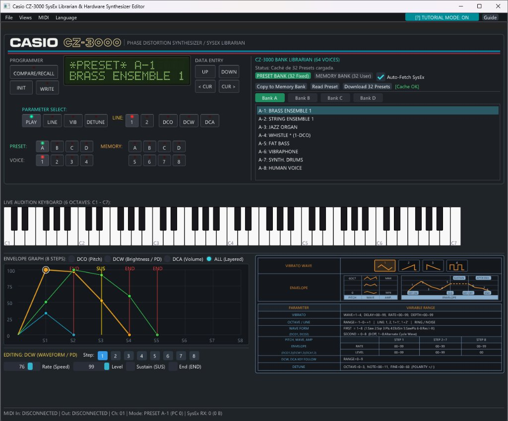

# Casio CZ-3000 SysEx Librarian & Hardware Synthesizer Editor (C++)

[](https://www.gnu.org/licenses/gpl-3.0)

🌐 **Sprache:** [English](README.md) · [Español](README.es.md) · [Italiano](README.it.md) · **Deutsch** · [日本語](README.ja.md) · [简体中文](README.zh.md) · [Português (BR)](README.pt-BR.md) · [Français](README.fr.md)

Moderne native **C++20**-Desktop-Anwendung mit hardwarebeschleunigter Oberfläche (**DirectX 11 + Dear ImGui**) für den **Casio CZ-3000** Synthesizer (kompatibel mit der Casio CZ-Familie: CZ-101, CZ-1000, CZ-3000, CZ-5000 und CZ-1).

Portiert und erweitert aus dem Python-Projekt `kasploosh` (`czsysexy` / `czcommon`).



---

## 🎹 Hauptfunktionen

1. **Authentische Casio CZ-3000 Hardware-Simulation**:
   - Retro-Gehäuse in Anthrazit mit klassischen Casio-Akzenten (Cyan, Dunkelblau und Rot).
   - **16×2 HD44780 LCD-Display**: 5×7-Punktmatrix in Phosphorgrün mit blinkendem Hardware-Cursor und echten Edit-Seiten (`Play`, `Line`, `Vibrato`, `Detune`, `DCO`, `DCW`, `DCA`).
   - **Taktile Casio-Bedienfeld-Taster & Status-LEDs**:
     - *Programmer*: `COMPARE/RECALL`, `INIT`, `WRITE`.
     - *Parameterwahl*: `PLAY`, `LINE`, `VIB`, `DETUNE`, `DCO`, `DCW`, `DCA`.
     - *Stimmen-Linien*: Line 1 und Line 2.
     - *Data Entry*: `UP`, `DOWN`, `< CUR`, `CUR >`.
     - *Bänke & Stimmen*: Preset- & Memory-Bänke `A`–`D` und Plätze `1`–`8` (insgesamt 64 Stimmen).
   - **6-Oktaven Live-Vorhör-Tastatur**: Interaktives virtuelles Piano (**C1** bis **C7**, 73 Tasten) für Echtzeit-MIDI-Vorhören.

2. **Interaktive 8-Stufen-Hüllkurvengrafik**:
   - Echtzeit-Visualisierung und -Bearbeitung der **DCO**- (Tonhöhe, Cyan), **DCW**- (Helligkeit/PD, Bernstein) und **DCA**-Kurven (Lautstärke, Limettengrün), einzeln oder überlagert (`ALL`).
   - Visuelle `SUS`- (Sustain) und `END`-Markierungen.
   - `Rate`- (0–99) und `Level`-Regler (0–99) für alle 8 Stufen.

3. **64-Stimmen Dual-Bank-Librarian (32 Presets + 32 User-Memories)**:
   - **PRESET BANK (32 Fest)** & **MEMORY BANK (32 User)** Tabs mit hardwaregetreuer `*MEMORY* A-1`-Benennung und Rechtsklick-Umbenennung (gespeichert über 296-Byte CZ-1 `.syx`-Export/-Import).
   - **Batch-Download & Preset-Cache**: Alle 32 Presets (lokal zwischengespeichert) oder alle 32 Memories mit einem Klick herunterladen.
   - **Auto-Fetch SysEx**: Fragt beim Klick auf einen Preset- oder Memory-Platz automatisch den Dump vom Gerät an.
   - **Synth-Patch-Randomizer (`Zufall` / `Randomize`)**: Erzeugt zufällige Werte für alle Synthesizer-Parameter (`Line Select`, `Octave`, `Detune`, `Vibrato`, Wellenformen, Modulation und 8-stufige DCO/DCW/DCA-Hüllkurven) im aktuellen Memory-Slot und sendet sie live an den Edit-Buffer (`0x60`).
   - An Edit-Buffer (`0x60`) senden, in Synth-Memory schreiben, komplette 32-Patch-Bank senden, zwischen Slots kopieren/einfügen sowie `.syx`-Dateien laden/speichern.

4. **Mehrsprachige Oberfläche, Interaktives PD-Handbuch & Offizielle Anleitung (8 Sprachen)**:
   - Sofortiger Sprachwechsel im Betrieb (**English**, **Español**, **Italiano**, **Deutsch**, **日本語**, **简体中文**, **Português (Brasil)**, **Français**) inklusive CJK-Schriftunterstützung.
   - **Tutorial-Modus (`[?] TUTORIAL-MODUS: ON/OFF`)**: Hover-Tooltips und ein interaktives **Phase-Distortion-Handbuch** zu DCO, DCW, DCA, 8-Stufen-Hüllkurven, Wellenformen, Ring-/Noise-Modulation und SysEx.
   - **Offizielle CZ-3000 Bedienungsanleitung**: Integriertes 9-Kapitel-Referenzhandbuch (`Ansichten → CZ-3000 Bedienungsanleitung`) mit 32-Preset-Tabelle, `INITIALIZE`-Standardwerten und MIDI-Implementierungstabelle in allen 8 Sprachen.

5. **Latenzarme native MIDI-Engine**:
   - Basiert auf der nativen Windows Multimedia API (`winmm.dll`) mit Hot-Swap-fähiger MIDI-In/Out-Auswahl und 263/264-Byte Casio-SysEx-Framing.

---

## 🛠️ Kompilieren & Ausführen

### Voraussetzungen
- Windows 10 oder 11 (x64)
- Visual Studio 2022 / Build Tools mit C++20-Unterstützung
- CMake 3.20+
- Git mit Submodulen (`git clone --recursive` oder `git submodule update --init --recursive`)
- *(Optional)* NSIS 3.x zum Erstellen des Windows-Installers

### Schnelles Kompilieren & Testen
```bat
build.bat
```
Erzeugt `build\Release\CZ3000SysEx.exe` sowie `build\Release\test_sysex.exe` und führt alle Core-Unit-Tests aus.

### Installer erstellen
```bat
build_installer.bat
```

---

## 📁 Projektstruktur

```
CZSYSEX/
├── docs/                  # Screenshots & Dokumentationsressourcen
├── external/
│   └── imgui/             # Dear ImGui Submodul + Win32/DX11-Backends
├── installer/             # NSIS-Installer-Skript
├── src/
│   ├── core/              # Datenmodell, Mathematik, i18n, SysEx-Codec & Bank-Cache
│   ├── midi/              # Windows Multimedia (WinMM) MIDI-Treiber
│   ├── ui/                # LCD, Tutorial, Handbuch, Hüllkurvengrafik, Librarian & Panel
│   └── main.cpp           # Win32-Fenster, DirectX 11 & Hauptschleife
├── tests/
│   └── test_sysex.cpp     # Unit-Tests für SysEx, Bank & Cache
├── AGENTS.md              # Richtlinien für Mitwirkende & CI-Verifikation
├── CMakeLists.txt
├── build.bat
└── build_installer.bat
```

---

## 📄 Lizenz

Veröffentlicht unter der **GNU General Public License v3.0 (GPLv3)**. Siehe [LICENSE](LICENSE) für Details.
